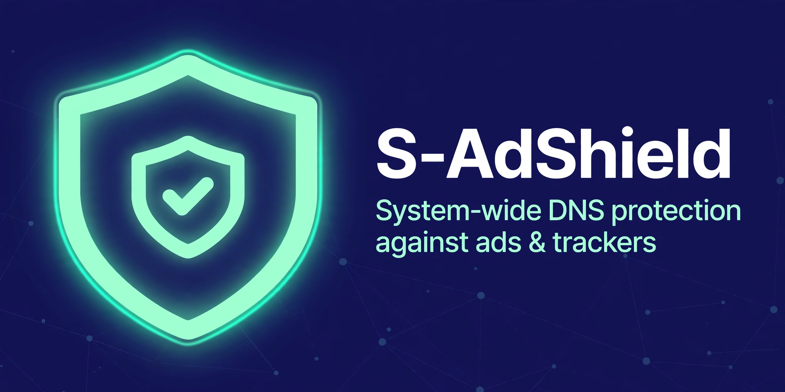

<p align="center">
  
</p>

<p align="center">
  
</p>

<h1 align="center">S-AdShield</h1>

<p align="center">
  <strong>System-wide DNS protection against ads &amp; trackers for Android.</strong><br>
  No root. No remote VPN server. No account. Nothing leaves your device.
</p>

<p align="center">
  <a href="https://github.com/shivytyahoo/S-AdShield/releases/latest">
    
  </a>
  <a href="https://github.com/shivytyahoo/S-AdShield/blob/main/LICENSE">
    
  </a>
  
  
</p>

---

## What it is

S-AdShield runs a **local VPN** on your phone that filters DNS queries. Every
app on the device — browser, social apps, games, everything — goes through the
same filter. Ad and tracker domains never resolve; everything else passes
through untouched.

- **Local only** — the VPN exists only on your device. There is no remote
  server, no account, no telemetry, no browsing-history upload.
- **250,000+ blocked domains** — HaGeZi Multi PRO, uBlock (DNS-converted),
  StevenBlack, a 7-network ad-network pack, and a Streaming SSAI pack.
- **Streaming Extreme** — an extra toggle that blocks the ad-decision and
  middleman calls (Google DAI/IMA, FreeWheel, SpotX, Innovid, SpringServe,
  Yospace, Amazon Publisher Services) around video streams.
- **Anti-Detect** — blocked domains answer with empty-but-valid content from
  a local stub, so sites that check "did the ad request fail?" don't show an
  "ad blocker detected" wall.
- **Live stats** — queries, blocked, and block rate on the Home screen.
- **Blocklist updates** — download fresh StevenBlack and HaGeZi lists from
  inside the app, on Wi-Fi only or on Wi-Fi or mobile data — your choice.
- **Battery friendly** — one tap to allow unrestricted battery use so the
  protection stays up 24×7.

## Install

1. Download the latest APK from
   [**Releases**](https://github.com/shivytyahoo/S-AdShield/releases/latest).
2. Allow installing from unknown sources when asked, then install.
3. Open S-AdShield, tap **START PROTECTION**, and accept the VPN prompt.

Updates install over the previous version — no reinstall needed.

## How it works

The local VPN routes **only DNS traffic** (the DNS server `/32`s and the
well-known public resolver `/32`s) into the app. Everything else flows
normally, outside the tunnel.

- A DNS query for a blocked domain gets the local stub IP (`10.10.10.3`),
  where a tiny built-in server answers with empty-but-valid content
  (Anti-Detect) — or NXDOMAIN when Anti-Detect is off.
- Any other query is forwarded verbatim to `8.8.8.8`, falling back to
  `1.1.1.1`, and the real answer is returned. Replies are cached
  (30–300 s) so repeat queries are instant.
- Hardcoded and encrypted DNS is routed into the same engine, so apps can't
  bypass the filter by using their own resolver.

Matching is a suffix walk: blocking `doubleclick.net` also blocks
`ads.doubleclick.net`, while `notdoubleclick.net` is never touched. An
allowlist is checked first, so content domains stay reachable.

## Honest limits

- **DNS-level only.** Ads served from the same host or CDN as the content
  (for example ads stitched into the video stream itself) can't be separated
  by DNS. S-AdShield blocks the ad *decision* calls around the stream —
  that's everything a DNS engine can reach.
- **No HTTPS filtering.** Version 1.0.0 removed the old HTTPS MITM engine
  entirely. Nothing is decrypted, no certificate is installed, and apps that
  refuse to run with a user CA are unaffected.
- Some apps hardcode IP addresses instead of domain names; those requests
  can't be filtered at DNS level.

## Filter sources

| Source | What it adds |
| --- | --- |
| [StevenBlack/hosts](https://github.com/StevenBlack/hosts) | Unified hosts list |
| [HaGeZi Multi PRO](https://github.com/hagezi/dns-blocklists) | 180k+ extra domains |
| [uBlock uAssets](https://github.com/uBlockOrigin/uAssets) | DNS-converted network rules |
| Ad-network pack | BidMachine, TopOn, TradPlus, Mintegral, Pangle, AppLovin, IronSource, Vungle, InMobi, GDT, MobAds |
| Streaming SSAI pack | Google DAI/IMA, FreeWheel, SpotX, Innovid, SpringServe, Yospace, Amazon Publisher Services |

Each list's own license and attribution are preserved. Lists are bundled with
the app and can be refreshed from **Lists → Update now**.

## Build from source

```bash
./gradlew :app:assembleRelease
```

The signed release APK lands at `app/build/outputs/apk/release/app-release.apk`.
Signing needs the release keystore — see `signing/` (not in this repo).

## Changelog

See [**Releases**](https://github.com/shivytyahoo/S-AdShield/releases) —
every version ships with notes. Current version: **v1.2.0**.

## License

MIT — see [LICENSE](LICENSE).

---

<p align="center">Developed with love by Shiv</p>
